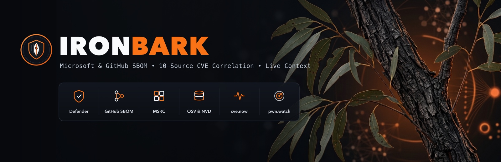

<p align="center">
  
</p>

# Ironbark

<p align="left">
  
  <strong>Microsoft Defender &amp; GitHub Security SBOM intelligence platform:</strong> ingest DevOps, <code>.NET</code>, container, and endpoint SBOMs and correlate every component and CVE across <strong>10 vulnerability and live-incident databases</strong> via Editorial Web UI, REST API (<code>.md</code> twins), CLI, SARIF v2.1.0, and MCP.
</p>

<br clear="left"/>

[](https://github.com/jusso-dev/ironbark/actions/workflows/ci.yml)
[](LICENSE)
[](package.json)

**[Getting Started](docs/getting-started.md)** · **[Documentation](docs/index.md)** · **[Architecture & Risk Scoring](docs/architecture.md)** · **[Connectors & CI/CD](docs/connectors-and-ci.md)** · **[REST, CLI & MCP](docs/api-cli-mcp.md)** · **[Disclaimer](DISCLAIMER.md)**

> [!IMPORTANT]
> **Ironbark is an independent open-source project. It is not affiliated with, endorsed by, or supported by Microsoft, GitHub, ProjectDiscovery, cve.now, or pwn.watch.** All API integrations remain governed by your own agreements, rate limits, and credentials with each respective upstream provider. The software is provided "as is" under the [MIT License](LICENSE), without warranty. Read [DISCLAIMER.md](DISCLAIMER.md) before production deployment.

## How it works

```
Microsoft sbom-tool / GitHub SBOM / .NET Lockfiles / Defender MDVM
  -> Universal Parser & PURL/CPE Normalizer -> SQLite + FTS5 Store
  -> 10-Database Parallel Correlator (MSRC, cve.now, pwn.watch, SecurityContext,
                                      OSV, GHSA, NVD 2.0, MITRE SSVC, KEV, EPSS)
  -> Web UI  |  REST /v1 (.md Twins)  |  SARIF v2.1.0  |  RSS/Atom  |  MCP
```

## Quick start

Requirements: **Node.js >= 22.5** (built-in `node:sqlite` + FTS5) and `pnpm`. See the full [Getting Started Guide](docs/getting-started.md).

```sh
git clone https://github.com/jusso-dev/ironbark.git
cd ironbark
pnpm install
pnpm run build
pnpm start
```

Open **http://127.0.0.1:8788** (first boot seeds an explicitly labeled synthetic demonstration estate: *Contoso Cloud & Federal — Demo Estate*; pass `--no-seed` for an empty database, or run `docker compose up --build`).

```sh
# Correlate a CVE live across all 10 databases
node ./bin/ironbark.mjs cve CVE-2024-43485 --live --format md

# Scan a Microsoft sbom-tool SPDX 2.2 manifest and output SARIF v2.1.0
node ./bin/ironbark.mjs scan examples/sboms/contoso-dotnet8-ms-sbom.spdx.json --live --format sarif

# Sync zero-key live feeds & public GitHub SBOMs
node ./bin/ironbark.mjs sync pwnwatch
node ./bin/ironbark.mjs sync cvenow
node ./bin/ironbark.mjs sync kev
node ./bin/ironbark.mjs sync github --repo facebook/react

# Start stdio MCP server
node ./bin/ironbark.mjs mcp
```

## 10 Correlated Vulnerability & Incident Databases

| Database | Role | Key Signals |
| --- | --- | --- |
| **Microsoft MSRC** | Vendor advisories (`SUG v2.0` / `CVRF v3.0`) | Exploitability Index, KB patches, fixed builds |
| **cve.now** | Batch package checker & early warnings | Vendor `exposure`, `fixedInByProduct`, `SZB-*` alerts, `agentPrompt` |
| **pwn.watch** | Breaking live security incidents | `patchStatus`, Microsoft/Windows/supply-chain timelines |
| **SecurityContext** | ProjectDiscovery exploit telemetry | Nuclei templates, public PoC counts, VulnCheck KEV |
| **Google OSV.dev** | Open-source & distro PURL matching | Batch queries, range events, `MAL-*` malicious packages |
| **GitHub GHSA** | Ecosystem advisory ranges | Patched versions, CWEs |
| **NIST NVD 2.0** | Canonical CVSS & CPE catalog | CVSS v3.1/v4.0 vectors, CWEs, `vulnStatus` |
| **MITRE CVE 5.2** | CNA & CISA Vulnrichment | CISA ADP SSVC triage (`Act`, `Attend`, `Track*`, `Track`) |
| **CISA KEV** | Active exploitation catalog | Confirmed exploitation & ransomware flags |
| **FIRST EPSS** | Exploitation probability | 30-day probability & percentile |

## Connectors & Environment Variables

Nine of the ten intelligence feeds and public GitHub dependency graphs require **zero credentials**. Configure `.env` (see [`.env.example`](.env.example)) for private enterprise environments—detailed setup steps live in [Getting Started](docs/getting-started.md#4-connect-github-microsoft-defender--azure-devops).

| Connector / Feed | Environment Variables |
| --- | --- |
| **GitHub GHAS & Private Repos** | `GITHUB_TOKEN` |
| **Microsoft Defender for Cloud / ARM** | `AZURE_TENANT_ID`, `AZURE_CLIENT_ID`, `AZURE_CLIENT_SECRET`, `AZURE_SUBSCRIPTION_ID` |
| **Microsoft Defender XDR / MDVM** | `DEFENDER_TENANT_ID`, `DEFENDER_CLIENT_ID`, `DEFENDER_CLIENT_SECRET` |
| **Azure DevOps Repos & Pipelines** | `AZDO_ORG_URL`, `AZDO_PROJECT`, `AZDO_PAT` |
| **NIST NVD / cve.now (higher rate limits)** | `NVD_API_KEY`, `CVENOW_API_KEY` |

## Documentation & Examples

- **Documentation Hub**: [`docs/index.md`](docs/index.md) (Web UI also serves interactive **`/getting-started`** and **`/docs`** pages, plus `/v1/getting-started.md` & `/v1/guide.md`)
- **GitHub Actions + `sbom-tool` + SARIF**: [`examples/github-actions/ironbark-sbom-scan.yml`](examples/github-actions/ironbark-sbom-scan.yml)
- **Azure DevOps (`ManifestGeneratorTask@0` + `MSDO`)**: [`examples/azure-pipelines/azure-pipelines-sbom.yml`](examples/azure-pipelines/azure-pipelines-sbom.yml)
- **Container deployment**: [`Dockerfile`](Dockerfile) and [`docker-compose.yml`](docker-compose.yml)

## License

Licensed under [MIT](LICENSE). See [CONTRIBUTING.md](CONTRIBUTING.md) and [DISCLAIMER.md](DISCLAIMER.md).
