# Architecture & Risk Scoring

Ironbark adapts the agent-native REST + Markdown-twin + MCP model of [SecurityContext](https://securitycontext.com/) for Microsoft and GitHub DevSecOps estates, correlating package inventories against 10 vulnerability and live-incident databases.

## System Topology

```mermaid
flowchart LR
  subgraph Sources["Microsoft, GitHub & Build Inputs"]
    S1["Microsoft sbom-tool (SPDX 2.2)"]
    S2["GitHub Dependency Graph & GHAS"]
    S3["Defender for Cloud (ARM / ARG)"]
    S4["Defender XDR / MDVM Endpoints"]
    S5[".NET Lockfiles & Polyglot Manifests"]
  end

  subgraph Core["Ironbark Engine"]
    P["Universal Parser & PURL/CPE Normalizer"]
    DB[("SQLite + FTS5 Store & HTTP Cache")]
    C["10-Database Parallel Correlator"]
    R["Consensus & Blast-Radius Risk Scorer"]
  end

  subgraph Feeds["10 Vulnerability & Incident Databases"]
    F1["MSRC · cve.now · pwn.watch · SecurityContext"]
    F2["OSV.dev · GHSA · NVD 2.0 · MITRE SSVC · CISA KEV · EPSS"]
  end

  subgraph Surfaces["Agent, CI/CD & Analyst Surfaces"]
    O1["Editorial Web UI"]
    O2["REST /v1 JSON + .md Twins + RSS/Atom"]
    O3["SARIF v2.1.0 (GitHub / MSDO)"]
    O4["MCP (Streamable HTTP + Stdio) & CLI"]
  end

  Sources --> P --> DB
  DB <--> C <--> Feeds
  C --> R --> Surfaces
```

---

## Supported SBOM, Manifest & Lockfile Formats

| Format / Tool | Detection & Extraction |
| --- | --- |
| **Microsoft `sbom-tool` SPDX 2.2** | Detects `Microsoft.SBOMTool` creator; extracts PURLs, CPEs, and `DESCRIBES`/`DEPENDS_ON` direct vs transitive edges |
| **GitHub Dependency Graph SPDX 2.3** | Automatically unwraps `{ "sbom": { ... } }` envelope returned by `/dependency-graph/sbom` |
| **SPDX 2.2 / 2.3 (Generic)** | Extracts `packages[]`, `externalRefs` (`purl`, `cpe23Type`), licenses, and relationships |
| **CycloneDX 1.4 – 1.6** | Walks nested `components[]`, dependency graphs, `scope` (`required` vs `optional`), and embedded VEX statements |
| **NuGet `packages.lock.json`** | Parses target framework dependencies (`Direct` vs `Transitive`), skips `Project` refs, maps to `pkg:nuget/...` |
| **`.csproj` / `Directory.Packages.props`** | Parses `<PackageReference>` and `<PackageVersion>` XML declarations |
| **`.NET *.deps.json`** | Extracts resolved `"type": "package"` libraries |
| **Polyglot Lockfiles** | `package-lock.json`, `Cargo.lock`, `requirements.txt`, `go.mod`, and plain PURL / CPE / `ecosystem/name@version` lists |
| **Microsoft Security DevOps SARIF** | Parses `runs[]` tool summaries (`Trivy`, `BinSkim`, `Terrascan`) and CVE rule IDs; **redacts secret rule snippets** |

---

## 10-Database Correlation & Consensus Model

### Alias Deduplication

Upstream databases differ in capitalization and primary identifiers (for example, `cve.now` emits uppercase `GHSA-5CRP-9R3C-P9VR` while OSV/GHSA emit `GHSA-5crp-9r3c-p9vr`). Ironbark normalizes GHSA and CVE identifiers canonically before merging advisory matches so each vulnerability appears once per package with combined source provenance.

### Severity Consensus (`consensusStatus`)

Across all databases that matched a CVE with a severity verdict:
- **`consensus`**: Two or more sources reported severities and all agree.
- **`divergent_severity`**: Two or more sources disagree (for example, MSRC rates a vulnerability **Important/High** while GHSA rates it **Medium**). Ironbark retains every source's severity in `severityDisagreements` and adopts the highest authoritative severity so risk is never understated when one catalog lags.
- **`single_source`**: Only one source provided a severity rating.

### Performance & Rate-Limit Protection

- **SQLite HTTP Cache**: Upstream API responses are cached in `http_cache` (`15m–6h` TTLs depending on source volatility) so repeated scans and dashboard navigation do not exhaust rate limits.
- **Transactional Batch Writes**: Large monorepo SBOMs (such as `facebook/react` at 7,700+ parsed components) are ingested inside a single SQLite transaction (`BEGIN`/`COMMIT`) with parallel `OSV` and `cve.now` batch chunking and bounded `SecurityContext` fan-out.
- **Sanitized FTS5 Queries**: User search strings pass through `sanitizeFtsQuery()` so hyphens, colons, `@`, and `/` in `CVE-2024-43485`, `@azure/msal-node`, and PURLs never trigger SQLite FTS5 syntax errors.

---

## Risk Score & Cheapest Attacker Path

In [`src/cve/risk.ts`](../src/cve/risk.ts), each repository and runtime asset receives a deterministic **`0–100` Risk Score** plus a human-readable **`cheapestAttackPath`** pointing to the highest-leverage remediation:

| Signal | Point Contribution |
| --- | --- |
| Base severity (`critical` / `high` / `medium` / `low`) | `60` / `48` / `36` / `24` |
| Listed on **CISA KEV** | `+30` |
| **Malicious package** (`MAL-*` / supply chain) | `+35` |
| Active **`pwn.watch`** live incident | `+18` |
| **`cve.now` Critical** flag | `+12` |
| **MSRC Exploitability** (`Detected` or `More Likely`) | `+12` |
| **Internet-facing** Defender asset linked | `+12` |
| **EPSS** probability `>= 10%` | `+10` |
| **Runtime** dependency scope (`!development`) | `+10` |
| Multiple affected components in SBOM | `+3` per extra package (capped at `+12`) |

*(Capped at `100` total; scores are heuristic triage ranks and not formal compliance verdicts.)*
